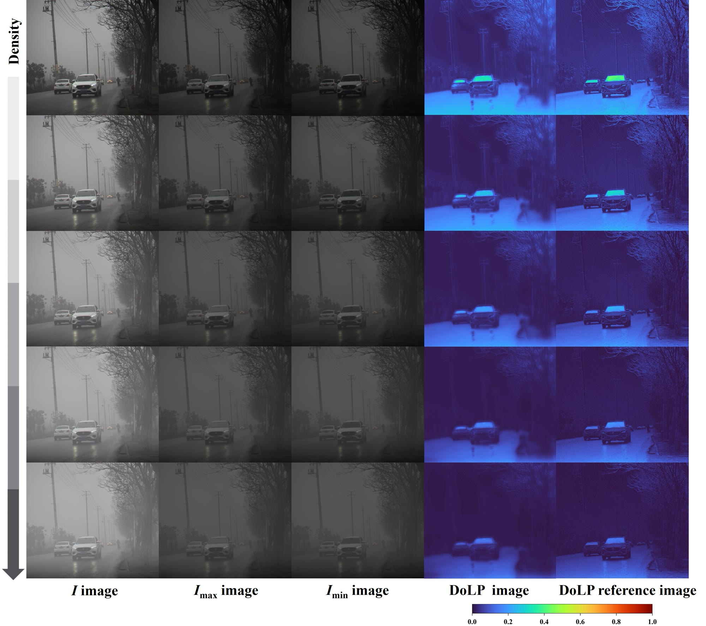
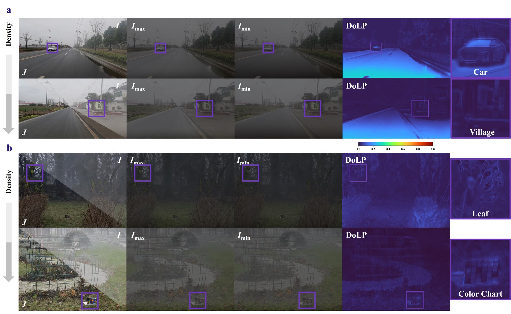
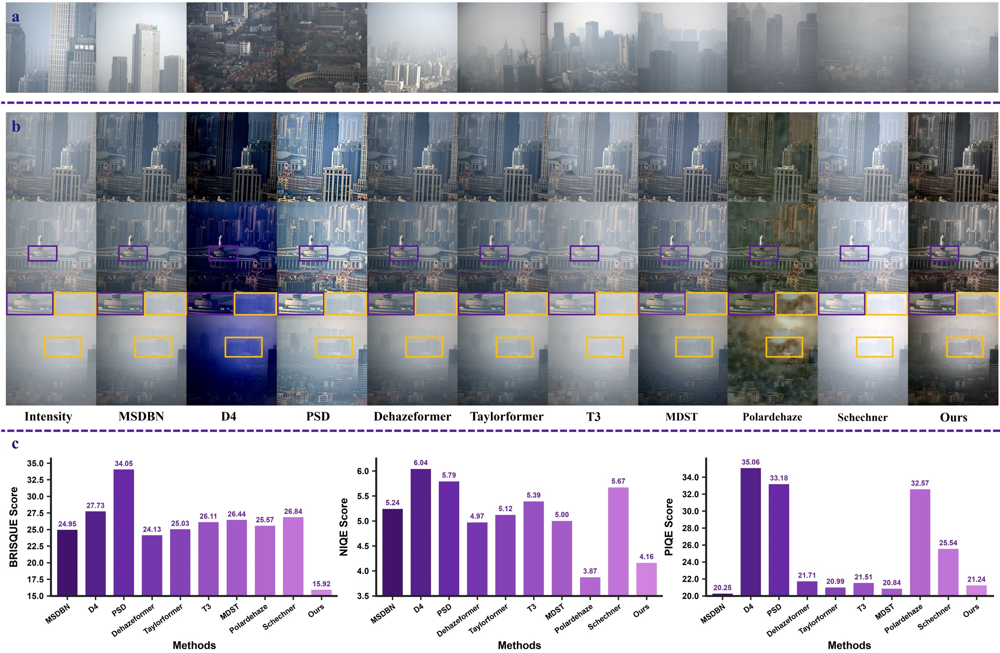
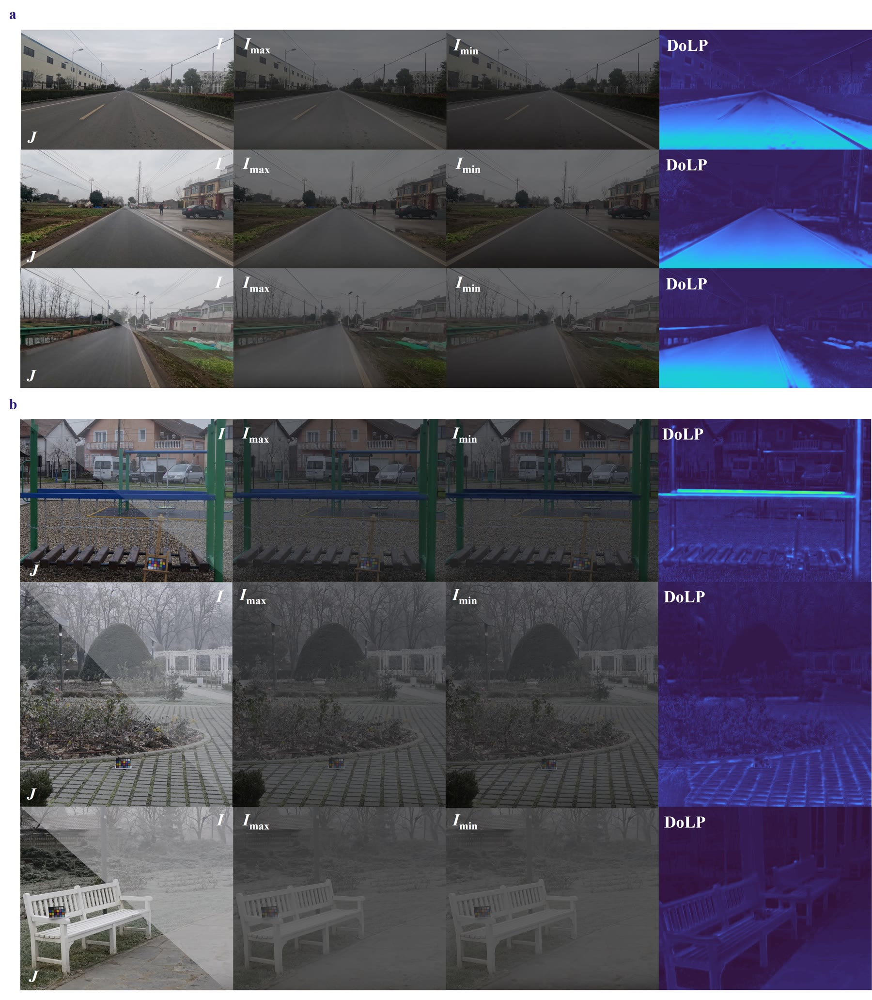
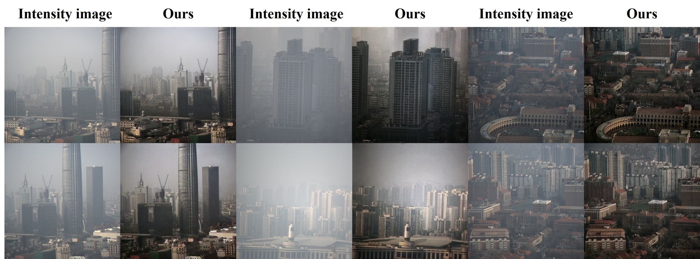
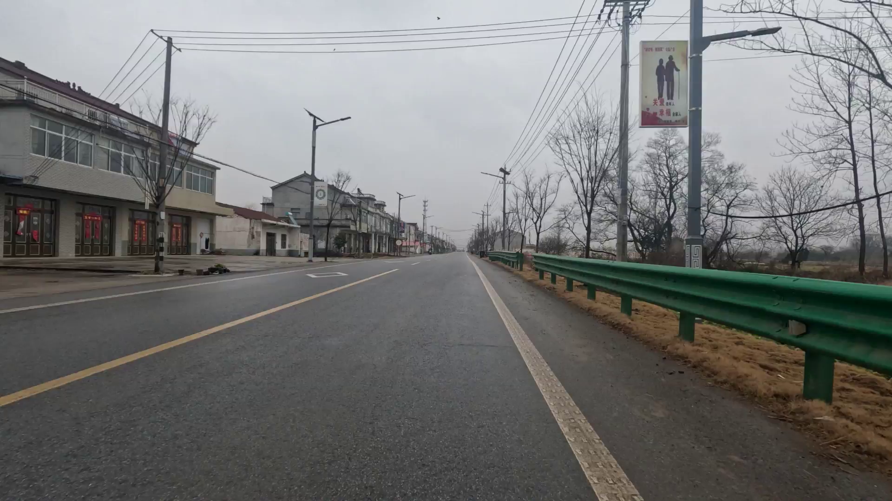
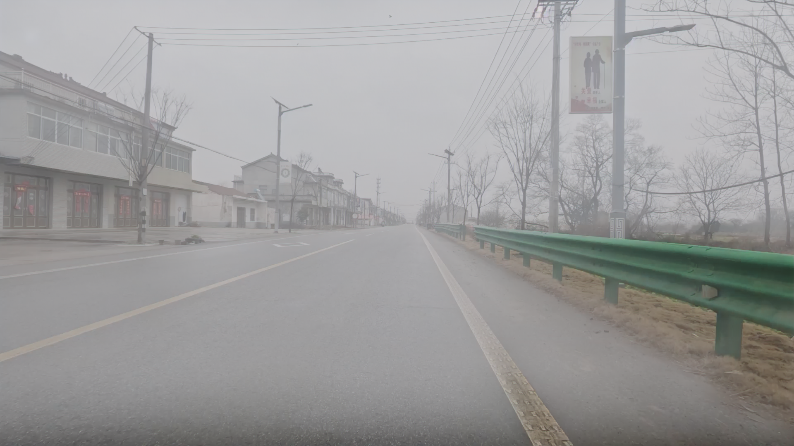
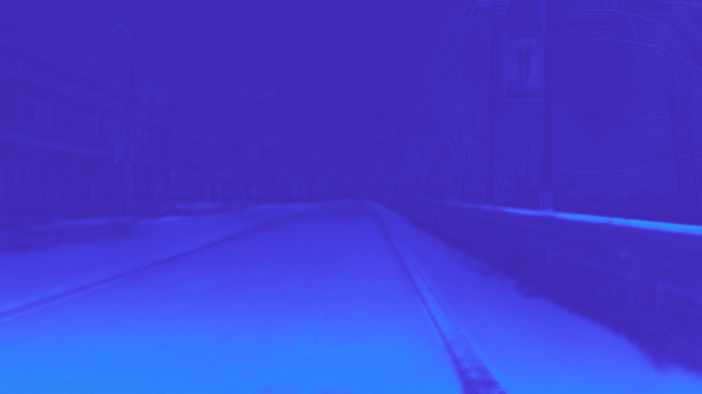

# PolarFog

  <b>PolarFog: Physics-Informed Information Fusion for Controllable Foggy Polarization Image Generation</b>

  <a href="#overview">Overview</a> |
  <a href="#visual-results">Visual Results</a> |
  <a href="#video-demo">Video Demo</a> |
  <a href="#installation">Installation</a> |
  <a href="#inference">Inference</a> |
  <a href="#citation">Citation</a>

---

## Overview

**PolarFog** is a physics-informed fusion imaging framework for controllable foggy polarization image generation from a clear intensity image.

Polarization imaging provides useful information for vision and restoration tasks in foggy environments. However, acquiring strictly pixel-aligned clear and foggy polarization image pairs in real-world scenes is difficult. PolarFog aims to alleviate this data bottleneck by generating foggy polarization-related images under controllable fog densities.

Given a clear intensity image, PolarFog can generate:

- Foggy intensity image `I`
- Maximum polarization image `Imax`
- Minimum polarization image `Imin`
- Degree of linear polarization image `DoLP`

---

## Visual Results

The figures below are taken from the manuscript and its supplementary material.

### Generation across fog densities

  

On the polar test set, fog density increases from top to bottom. Each row shows the generated intensity image `I`, `Imax`, `Imin`, the predicted DoLP, and the reference DoLP.

### Results on GoPro and O-HAZE

  

PolarFog applied to clear intensity images from external datasets. (a) GoPro. (b) O-HAZE. Purple boxes mark the enlarged regions.

### Real-world polarization defogging

  

A network trained on Polar-GoPro, tested on real aerial foggy scenes and compared with intensity-based and polarization-based defogging methods.

### Additional qualitative results

  

Further generation examples on GoPro (a) and O-HAZE (b) under different fog densities.

  

Additional real-world defogging pairs. Each pair shows the foggy intensity image and the restored result.

---

## Video Demo

The following demos show the clear input images, the generated foggy intensity images and the corresponding DoLP results produced by the computational imaging framework PolarFog.

<table>
  <tr>
    <td align="center"><b>Clear Input Video</b></td>
    <td align="center"><b>Generated Foggy Intensity Video</b></td>
    <td align="center"><b>Generated DoLP Video</b></td>
  </tr>
  <tr>
    <td align="center">
      
    </td>
    <td align="center">
      
    </td>
    <td align="center">
      
    </td>
  </tr>
  <tr>
    <td align="center">
      <a href="https://github.com/polarhi/PolarFog/raw/main/assets/clear.mp4">View video</a>
    </td>
    <td align="center">
      <a href="https://github.com/polarhi/PolarFog/raw/main/assets/foggy_intensity.mp4">View video</a>
    </td>
    <td align="center">
      <a href="https://github.com/polarhi/PolarFog/raw/main/assets/dolp.mp4">View video</a>
    </td>
  </tr>
</table>

## Installation
More details will be published soon.
